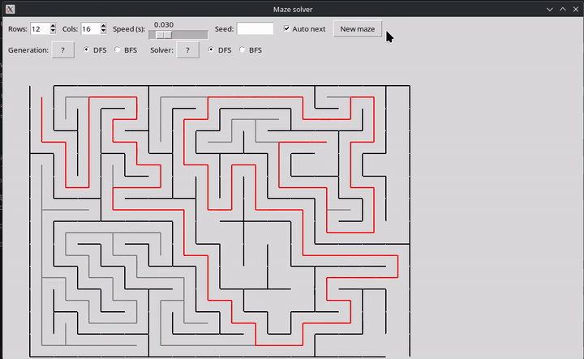

# Maze Solver

A Python + Tkinter maze generator and solver with animated generation, animated solving, and interactive controls.

The maze is generated as a perfect grid maze — every cell is reachable, and there is exactly one path between any two cells.

## Demo



## Features

- Animated maze generation and solving
- Choose **DFS** or **BFS** for maze generation
- Choose **DFS** or **BFS** for solving
- Adjustable row and column counts
- Adjustable animation speed
- Optional seed for reproducible mazes
- Auto-next mode for generating mazes continuously
- **New maze** button that immediately replaces the current maze
- Built-in `?` help buttons explaining the algorithms
- No external Python dependencies

## Controls

| Control | Description |
| --- | --- |
| **Rows** | Number of rows in the next maze |
| **Cols** | Number of columns in the next maze |
| **Speed (s)** | Delay between animation steps; `0` is instant |
| **Seed** | Seed for repeatable mazes; leave blank for random mazes |
| **Auto next** | Automatically generate another maze after solving |
| **New maze** | Interrupt the current maze and start a new one |
| **Generation** | Choose DFS or BFS for carving the maze |
| **Solver** | Choose DFS or BFS for finding the exit |
| **?** | Show an explanation of the selected generation or solving algorithm |

## Algorithms

### Maze generation

- **DFS (recursive backtracker)** — carves as deep as possible before backtracking. Produces long, winding corridors with fewer branches and dead ends.
- **BFS** — grows the maze outward level by level using a queue. Produces many short branches and a bushier maze, so routes from the entrance tend to be shorter.

Both algorithms create a perfect maze.

### Maze solving

- **DFS (depth-first search)** — dives down one path as far as possible, then backtracks from dead ends. Explored/backtracked paths are drawn in gray, and the final solution is drawn in red.
- **BFS (breadth-first search)** — explores level by level and guarantees the shortest path. Because the generated maze is perfect, the final route is the same as DFS, but the exploration spreads outward instead of diving deep.

## Requirements

- Python 3.10 or newer
- Tkinter (usually included with Python)

On Linux, Tkinter may need to be installed separately:

```bash
sudo apt install python3-tk
```

## Running

From the project directory:

```bash
python3 main.py
```

## Running the tests

```bash
python3 -m unittest tests -v
```

Or:

```bash
python3 tests.py
```

## Project structure

```text
.
├── main.py       # Application loop, maze creation, and control flow
├── maze.py       # Cell grid, maze generation, and solving algorithms
├── cell.py       # Cell walls, visited state, and cell/path drawing
├── graphics.py   # Tkinter window, canvas, controls, Point, and Line
├── tests.py      # Unit tests
├── maze.gif      # Optimized demo preview
└── maze.mp4      # Full-quality demo video
```

## How it works

- The maze is stored as a 2D grid of `Cell` objects.
- Each cell tracks four walls and a visited flag.
- Generation starts at the top-left cell, removes walls to connect cells, and creates a spanning tree.
- The entrance is the top wall of the first cell; the exit is the bottom wall of the last cell.
- Solving walks between cells through removed walls and draws the path on the canvas.
